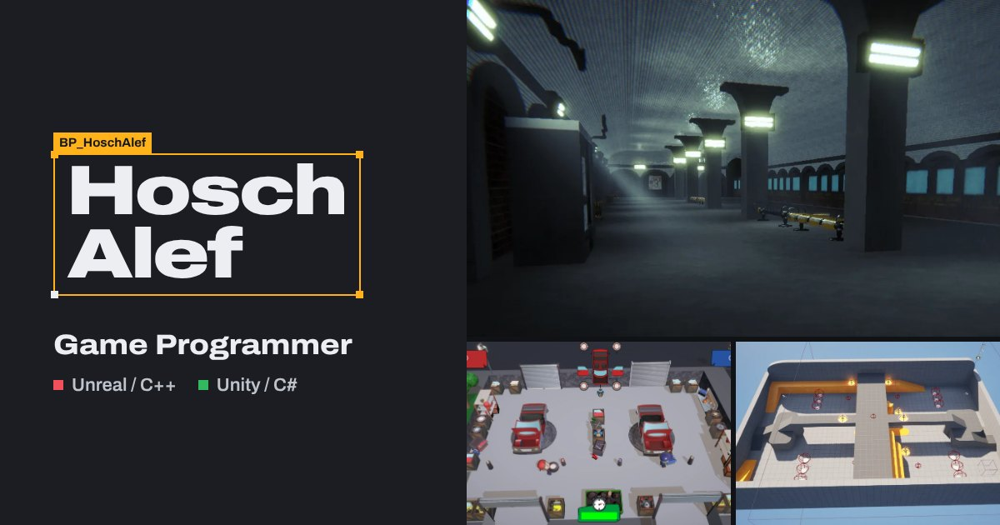

# Hosch Alef, game programmer

[](https://loboodst.github.io/siteportifolio/)

My portfolio: gameplay programming in C++ with Unreal and C# with Unity.

**Live site:** https://loboodst.github.io/siteportifolio/

The page looks like a greyboxed level open in an engine editor. My name is the
selected actor (drag it sideways and it springs back), and each project opens
on its gameplay video, followed by what I built and how it works. It's
available in English, Portuguese and French, and remembers the visitor's
choice.

## Run it locally

You need Node.js 20.19 or newer.

```bash
git clone https://github.com/LOBOodst/siteportifolio.git
cd siteportifolio
npm install
npm run dev
```

Then open http://localhost:3000/siteportifolio/.

| Command | What it does |
|---|---|
| `npm run dev` | Dev server with hot reload |
| `npm run build` | Production build in `dist/` |
| `npm run preview` | Serves the production build locally |
| `npm run check` | Biome lint and format (fixes what it can) |

## Editing the content

Every text the visitor reads lives in `src/data/`, and each one has a
`{ pt, en, fr }` version.

| File | Holds |
|---|---|
| `projects.js` | Projects: title, tags, images, videos, write-up, facts, links |
| `skills.js` | The Stack section |
| `translations.js` | Interface text, the About section and the contact links |

**Adding a project.** Copy an entry in `projects.js` and change it. Optional
fields that are left out (`facts`, `myWork`, `links`) don't render, and a link
set to `"#"` is hidden. `featured: true` gives the project the large layout at
the top of the list. Engine filters and the red/green marker come from the
`tech` tags (`Unreal Engine 5` / `C++` or `Unity` / `C#`).

**Images** go in `public/images/`. Only real screenshots from the game builds.

**Videos.** A YouTube link (`https://www.youtube-nocookie.com/embed/<id>`)
works as is. For a local clip, compress it and save a still frame next to it
with the same name, which the site uses as the poster and thumbnail:

```bash
# about 3 to 5x smaller, same resolution, sound kept
ffmpeg -i clip-raw.mp4 -c:v libx264 -crf 26 -preset slow -pix_fmt yuv420p \
  -c:a aac -b:a 96k -movflags +faststart public/videos/clip.mp4

# poster frame, 3 seconds in
ffmpeg -ss 3 -i public/videos/clip.mp4 -frames:v 1 -vf scale=1280:-2 public/videos/clip.webp
```

**CV.** Replace the PDF in `public/CV/` and point `cvPath` in
`translations.js` at it.

**Share image.** `public/images/og-card.jpg` (1200×630) is what LinkedIn,
Discord and others show when the link is pasted.

Write-ups follow the Voice rules in [`DESIGN.md`](DESIGN.md): say what the
mechanic does, and only claim what the build or the footage shows.

## Deploying

Every push to `main` builds the site and publishes it to GitHub Pages through
`.github/workflows/deploy.yml`. Nothing to do by hand.

## How it's built

- React 19 and Vite
- Tailwind CSS v4, with the design tokens in `src/index.css`
- Motion for animation, with `prefers-reduced-motion` respected everywhere
- Archivo, self-hosted, so no requests go to Google Fonts
- Biome for lint and formatting

```text
src/
  components/   hero, navigation, projects, stack, profile, contact
  context/      language and the open project (deep links like #psychastenia)
  data/         all the content (see above)
  hooks/        the Konami code
  utils/        asset URLs and video handling
public/         images, videos, CV
DESIGN.md       colours, type, layout, motion and writing rules
```

**Security.** A Content Security Policy in `index.html` only allows the
site's own scripts and YouTube embeds, the referrer policy is
`strict-origin-when-cross-origin`, and every external link opens with
`rel="noopener noreferrer"`.

## Things to find

- Type ↑ ↑ ↓ ↓ ← → ← → B A on the page to turn on "debug draw".
- Open the browser console.
